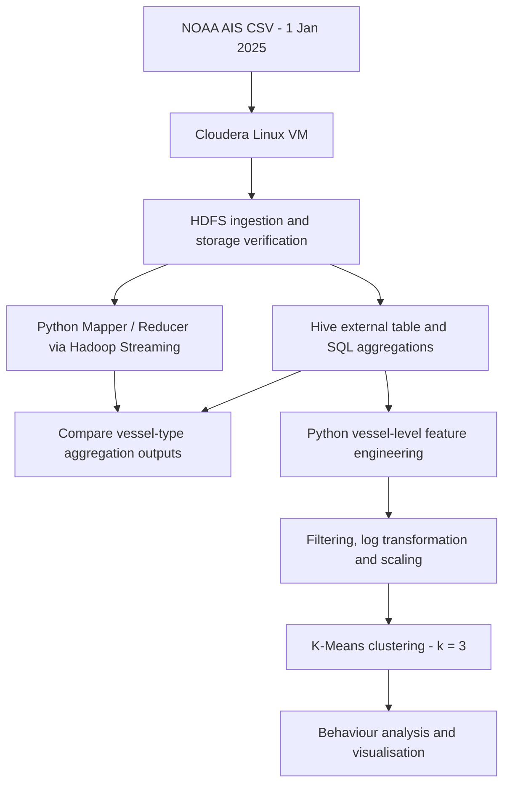

# Large-Scale AIS Vessel Traffic Analysis

**Maritime big-data processing and vessel-behaviour clustering**  
**Academic project · 2026**  
**Technologies:** Apache Hadoop · HDFS · YARN · Hadoop Streaming MapReduce · Apache Hive · Python · pandas · scikit-learn · Jupyter Notebook · Cloudera (Linux virtual machine)

Project files: https://github.com/myakin0/AIS-Cloudera-Project
> **Project in brief:** Processed **7,337,208 AIS observations** from a single day of U.S. vessel traffic data, compared Python-based Hadoop Streaming MapReduce with Hive aggregations, and grouped **15,341 vessels** into three movement-behaviour clusters.

## Overview

Automatic Identification System (AIS) data contains timestamped information about vessel positions, speed, course, and physical characteristics. At national scale, even a single day produces millions of observations.

This academic project explored the question:

**How can large-scale AIS vessel traffic data be stored, processed, and analysed using Hadoop technologies to support vessel-behaviour and congestion-related analysis?**

The goal was to create an end-to-end academic analytics workflow—from raw AIS records to aggregated traffic indicators and unsupervised vessel segmentation. The study focuses on **potential operational signals**; it does **not** claim to identify confirmed port congestion or predict arrival delays.

## Project at a glance

| Item | Documented result |
| --- | --- |
| Data source | NOAA / MarineCadastre nationwide AIS vessel traffic data |
| Observation date | **1 January 2025** |
| AIS records read in Hive | **7,337,208** |
| Raw CSV file size in HDFS | **750,244,099 bytes** (~715.5 MiB) |
| HDFS storage check | **HEALTHY**, six validated blocks (128 MiB configured block size) |
| Hadoop environment | **Single-node Cloudera virtual machine** |
| Unique vessels in initial vessel-level feature table | **16,286** |
| Vessels retained for clustering | **15,341** (at least 10 AIS messages each) |
| K-Means model | **3 clusters** |
| Silhouette score | **0.4342** |

## Analytical workflow



### 1. Hadoop environment and data ingestion

The AIS CSV was imported into HDFS within a **single-node Cloudera virtual machine**. Hadoop services, the HDFS DataNode, and the YARN node were checked before running the analysis.

The HDFS filesystem check reported a healthy file split into **six validated blocks**. The environment had **one DataNode and a replication factor of one**. This demonstrates Hadoop storage and job execution in a local academic environment, **not** the throughput or fault tolerance of a production multi-node cluster.

### 2. Hadoop Streaming MapReduce and Hive

Two approaches addressed the same vessel-type aggregation problem:

- **Hadoop Streaming MapReduce:** Custom Python mapper and reducer scripts grouped AIS messages by numerical `vessel_type` and calculated message count, average speed over ground (`SOG`), and maximum SOG.
- **Apache Hive:** An external table (`ais_raw`) was created over the HDFS CSV data. Column ordering was checked against the source data, and `OpenCSVSerde` was used for CSV parsing. Hive SQL queries calculated comparable vessel-type statistics and an additional hourly activity summary.

Both approaches identified the same leading vessel-type groups after sorting the MapReduce output: **codes 37, 31, and 52** had the largest message volumes. Vessel-type codes were **not decoded into named vessel classes** as part of this assignment.

The hourly Hive analysis produced 24 hourly groups showing AIS message counts, unique vessels, and mean SOG across the day.

**Interpretation caution:** AIS message counts are **not** vessel counts. Reporting frequency and time spent within coverage can change how strongly an individual vessel contributes to the results. Similarly, unusually high maximum speeds may reflect isolated readings or AIS anomalies.

### 3. Vessel-level features and machine learning

For the clustering stage, records were aggregated by **MMSI** into vessel-level profiles. The engineered features were:

| Feature | Meaning |
| --- | --- |
| `message_count` | Number of AIS observations for a vessel |
| `avg_sog` | Mean speed over ground |
| `max_sog` | Maximum recorded speed over ground |
| `stationary_ratio` | Fraction of observations with SOG **below 0.5 knots** |
| `avg_length` | Mean reported vessel length |
| `avg_width` | Mean reported vessel width |
| `avg_draft` | Mean reported vessel draft |

The initial vessel-level table contained **16,286 vessels**. Vessels with fewer than ten AIS messages were removed, leaving **15,341 vessels**. Message counts were log-transformed to reduce skew, and the selected features were standardised with `StandardScaler` before clustering.

The elbow method informed a practical, interpretable choice of **three K-Means clusters**. The final model reported **inertia = 51,963.81** and **silhouette score = 0.4342**. These are unsupervised clustering metrics, **not predictive accuracy scores**.

## Key findings

| Cluster | Vessels | Mean SOG (knots) | Mean stationary ratio | Interpretation |
| --- | ---: | ---: | ---: | --- |
| **0** | 3,140 | 5.442 | 0.278 | Smaller, relatively mobile vessels |
| **1** | 9,994 | 0.232 | 0.951 | Predominantly slow-moving or stationary vessels |
| **2** | 2,207 | 4.992 | 0.493 | Larger commercial vessels with mixed movement |

Cluster 1 was the largest group and exhibited very low speeds and a high proportion of stationary observations. Cluster 2 featured notably larger vessels (mean reported length **212.633 m**, width **31.879 m**, draft **7.912 m**).

**Operational interpretation:** These segments may help investigate anchorage activity, slower-moving traffic, or contrasting vessel operating patterns. **They do not establish why any vessel was stationary**, whether a particular port was congested, or how long a vessel was delayed.

## Implementation and reproducibility

The original implementation used:

- A Cloudera Linux virtual machine with Hadoop/HDFS and YARN services.
- Python Hadoop Streaming scripts named `mapper_vessel_type.py` and `reducer_vessel_type.py`.
- Hive SQL scripts for the external table, vessel-type aggregations, and hourly traffic summaries.
- Python/Jupyter for vessel-level features, preprocessing, K-Means, evaluation, and visualisation.

Example HDFS ingestion command documented in the report:

```bash
hdfs dfs -mkdir -p /user/cloudera/bda_ais_project/input/raw
hdfs dfs -put ~/bda_ais_project/data/ais-2025-01-01.csv \
  /user/cloudera/bda_ais_project/input/raw/
```

The recorded Hadoop Streaming job invocation was:

```bash
hadoop jar /usr/lib/hadoop-mapreduce/hadoop-streaming.jar \
  -D mapreduce.job.name="AIS Vessel Type Analysis" \
  -files mapper_vessel_type.py,reducer_vessel_type.py \
  -mapper "python mapper_vessel_type.py" \
  -reducer "python reducer_vessel_type.py" \
  -input /user/cloudera/bda_ais_project/input/raw/ais-2025-01-01.csv \
  -output /user/cloudera/bda_ais_project/output/mapreduce/vessel_type_analysis
```

These commands document the academic environment; local directories and software versions may differ elsewhere. **Reproduction requires the original source scripts, Hive SQL and notebook**, plus access to the AIS dataset. The uploaded report alone is not a runnable project package.

## Dataset and references

- [NOAA — Nationwide AIS 2025 dataset](https://www.fisheries.noaa.gov/inport/item/77594)
- [NOAA Digital Coast — AccessAIS](https://coast.noaa.gov/digitalcoast/tools/ais.html)
- [Apache Hadoop — HDFS Users Guide](https://hadoop.apache.org/docs/stable/hadoop-project-dist/hadoop-hdfs/HdfsUserGuide.html)
- [Apache Hadoop — Hadoop Streaming](https://hadoop.apache.org/docs/stable/hadoop-streaming/HadoopStreaming.html)

The raw AIS CSV is **not included** in this README. Obtain data through the authoritative source and follow its applicable usage conditions.

## Limitations and future directions

- **One day of observations:** Results should not be generalised to seasonal, weekly, or long-term vessel traffic patterns.
- **Single-node cluster:** The setup demonstrates Hadoop tools but does not benchmark production distributed-cluster scaling.
- **No ground-truth congestion labels:** Neither slow movement nor stationary time alone proves port congestion, anchorage waiting, or delays.
- **AIS quality constraints:** Missing or anomalous vessel attributes, uneven reporting rates, and possible speed outliers can affect aggregates and clusters.
- **Unsupervised clusters:** The three groups are analytical interpretations, not independently validated vessel activity classes.

Useful extensions would include multi-day AIS analysis, geographic port/anchorage context, validation against port-call or berth-event data, and testing alternative clustering or anomaly-detection approaches.

---

*This README summarises a completed **2026 academic assignment** on Hadoop-based maritime data processing. Numerical findings and methodology are taken from the assignment report; it is not a claim of production deployment or a validated congestion-prediction system.
Project by Mustafa Efe Yakın · MSc Data Analytics ·*
